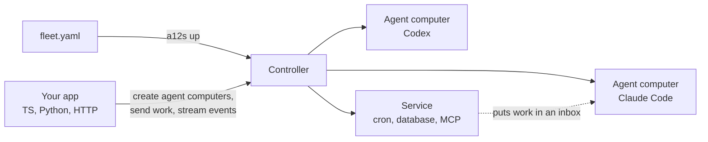

<p align="center">
  <picture>
    <source media="(prefers-color-scheme: dark)" srcset=".github/assets/logo-dark.svg">
    
  </picture>
</p>

<p align="center"><b>Run AI coding agents as isolated computers.</b></p>

<p align="center">
  <a href="https://github.com/coltonkirsten/a12s/actions/workflows/ci.yml"></a>
  <a href="https://www.npmjs.com/package/@coltonkirsten/a12s"></a>
  <a href="https://pypi.org/project/a12s/"></a>
  <a href="https://github.com/coltonkirsten/a12s/releases/latest"></a>
  <a href="LICENSE"></a>
</p>

## What is a12s?

a12s runs Claude Code and Codex agents on your machine as agent computers: each one is its own Docker container
with its own disk, conversation and inbox. You create them from code or from one file, and send them work from
TypeScript, Python or the command line.

<table>
<tr><th>Python</th><th>TypeScript / JavaScript</th></tr>
<tr><td>

```python
import a12s

fleet = a12s.Fleet()            # connects to the running fleet (or url=, token=)
hello = fleet.agent_computers.create("hello", instructions="Be helpful")
print(hello.send("hi").wait().text)
hello.remove()
```

</td><td>

```js
import { Fleet } from "@coltonkirsten/a12s";

const fleet = await Fleet.connect();
const hello = await fleet.agentComputers.create("hello", { instructions: "Be helpful" });
console.log((await hello.send("hi").wait()).text);
await hello.remove();
```

</td></tr>
</table>

- **They keep their state.** Stop an agent computer and start it tomorrow: its files and conversation are still there.
- **They are locked down.** No network except the hosts you list, no root, and credentials only on tmpfs inside them.
- **They take work like a queue.** Send a task while an agent is busy or asleep; it runs when the agent is free.

Using a coding agent? Give it this one file: https://raw.githubusercontent.com/coltonkirsten/a12s/main/llms.txt

## Install

```sh
brew install coltonkirsten/tap/a12s      # the CLI (macOS and Linux); or a binary from Releases
npm install @coltonkirsten/a12s          # TypeScript / JavaScript SDK
pip install a12s                         # Python SDK
```

Needs Docker running, and a Claude subscription or an Anthropic API key.

## Quickstart

Write a `fleet.yaml` in a new folder. `defaults` is what every agent computer gets unless it sets its own:

```yaml
apiVersion: a12s.ai/v1alpha1
kind: Fleet
metadata: { name: demo }
defaults:
  harness: { kind: claude-code, version: 2.1.280 }
  image: slim
  credentials: [anthropic]
agent_computers:
  pong:
    instructions: Reply to every message with the single word pong.
```

Start it:

```sh
claude setup-token                       # prints a long-lived token; or use an API key
a12s creds set anthropic                 # paste it
a12s up                                  # the first run downloads the images (about 1.5 GB)
a12s send pong "ping" --wait
```

Then run the code above in the same folder (`python hello.py`, or `node hello.mjs`): it creates the agent computer
`hello` from the defaults, sends it a message, prints its reply and removes it. `a12s down` stops everything and keeps the disks. `a12s init`
writes a starter Fleet like this one if you'd rather not type it.

## How it works



- **Fleet:** your agent computers and helpers (Services). `fleet.yaml` declares them and `a12s up` makes the machine
  match it; the SDK and the HTTP API add, change and remove them while the Fleet runs.
- **Controller:** a small server on your machine that starts the containers, holds the credentials and queues work.
- **Agent computer:** one agent with its own disk, conversation and inbox. Its network is closed except for the hosts
  you allow.
- **Service:** a non-agent container, such as a clock, an MCP server or a database, that may only do what the
  Fleet grants it.

## Examples

[a12s-cookbook](https://github.com/coltonkirsten/a12s-cookbook) has complete examples in TypeScript and Python:

| Example | What it shows |
|---|---|
| [Stream a reply](https://github.com/coltonkirsten/a12s-cookbook/tree/main/examples/stream-a-reply) | Send one coding agent a task from a script and print its answer as it streams. |
| [Browser agent](https://github.com/coltonkirsten/a12s-cookbook/tree/main/examples/browser-agent) | Extend a12s: your own image with Chromium, and a seccomp profile set in `fleet.yaml`. |

## Docs

- [Concepts](docs/concepts.md): Fleet, agent computer, Message, Turn and Event, in a few minutes.
- [Recipes](docs/recipes.md): agents that hand work to each other, web apps, schedules, webhooks, tools and network access.
- [SDK](docs/sdk.md): TypeScript and Python, side by side.
- Reference: [Fleet file](docs/fleet-file.md) · [CLI](docs/cli.md) · [HTTP API](docs/api.md) ·
  [Inbox and power](docs/inbox.md) · [Services](docs/services.md) · [Credentials](docs/credentials.md) ·
  [Extending](docs/extending.md) · [Images](docs/images.md) · [Security](docs/security.md) ·
  [Architecture](docs/architecture.md)
- Coding agents: [`llms.txt`](https://raw.githubusercontent.com/coltonkirsten/a12s/main/llms.txt) is everything an agent needs to build on a12s, on one page.

a12s is early (`a12s.ai/v1alpha1`). It runs on Docker Desktop on macOS (arm64) and Docker Engine on Linux (amd64,
arm64). The Fleet file and API may change before 1.0; [CHANGELOG](CHANGELOG.md) says what changed.

## Contributing

Bug reports and pull requests are welcome. [CONTRIBUTING.md](CONTRIBUTING.md) covers building from source and the
checks a PR must pass. Report security issues privately: [SECURITY.md](SECURITY.md).

## License

[MIT](LICENSE)
