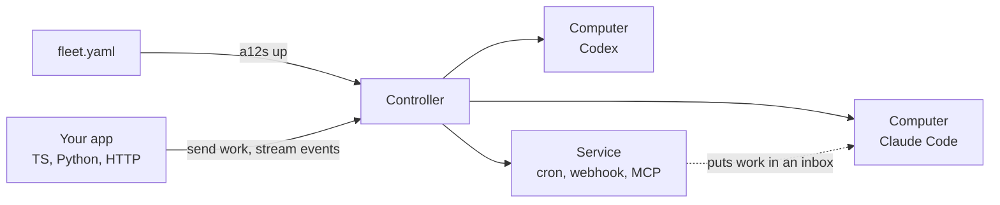

<p align="center">
  <picture>
    <source media="(prefers-color-scheme: dark)" srcset=".github/assets/logo-dark.svg">
    
  </picture>
</p>

<p align="center"><b>Run AI coding agents as isolated computers.</b></p>

<p align="center">
  <a href="https://github.com/coltonkirsten/a12s/actions/workflows/ci.yml"></a>
  <a href="https://www.npmjs.com/package/@coltonkirsten/a12s"></a>
  <a href="https://pypi.org/project/a12s/"></a>
  <a href="https://github.com/coltonkirsten/a12s/releases/latest"></a>
  <a href="LICENSE"></a>
</p>

## What is a12s?

a12s runs Claude Code and Codex agents on your machine, each in its own Docker container with its own
disk, conversation and inbox. You describe them in one file, start them with one command, and send them work from
TypeScript, Python or the command line.

- **They keep their state.** Stop an agent and start it tomorrow: its files and conversation are still there.
- **They are locked down.** No network except the hosts you list, no root, and credentials kept only in memory.
- **They take work like a queue.** Send a task while an agent is busy or asleep; it runs when the agent is free.

## Install

```sh
brew install coltonkirsten/tap/a12s      # the CLI (macOS and Linux); or a binary from Releases
npm install @coltonkirsten/a12s          # TypeScript / JavaScript SDK
pip install a12s                         # Python SDK
```

Needs Docker running, and a Claude subscription or an Anthropic API key.

## Quickstart

Start one agent:

```sh
a12s init hello && cd hello              # writes fleet.yaml: one Claude Code agent named "hello"
claude setup-token                       # prints a long-lived token; or use an API key
a12s creds set anthropic                 # paste it
a12s up                                  # the first run downloads the images (about 1.5 GB)
a12s prompt hello "Reply with the single word pong."
```

Then send it work from code:

<table>
<tr><th>TypeScript / JavaScript (<code>hello.mjs</code>)</th><th>Python (<code>hello.py</code>)</th></tr>
<tr><td>

```js
import { connect } from "@coltonkirsten/a12s";

const a12s = await connect();
const turn = await a12s.prompt("hello", "Name three prime numbers.");
console.log(turn.text);
```

</td><td>

```python
import a12s

client = a12s.connect()
turn = client.prompt("hello", "Name three prime numbers.")
print(turn.text)
```

</td></tr>
</table>

Run it in the same folder: `node hello.mjs` or `python hello.py`. `a12s down` stops everything and keeps the disks.

## How it works



- **Fleet file:** `fleet.yaml` lists your agents (Computers) and helpers (Services). `a12s up` makes the machine match it.
- **Controller:** a small server on your machine that starts the containers, holds the credentials and queues work.
- **Computer:** one agent with its own disk, conversation and inbox. Its network is closed except for the hosts you allow.
- **Service:** a non-agent container, such as a clock, a webhook receiver or a database, that may only do what the
  Fleet file grants it.

## Examples

[a12s-cookbook](https://github.com/coltonkirsten/a12s-cookbook) has complete examples in TypeScript and Python:

| Example | What it shows |
|---|---|
| [Stream a reply](https://github.com/coltonkirsten/a12s-cookbook/tree/main/examples/stream-a-reply) | Send one coding agent a task from a script and print its answer as it streams. |
| [Scheduled agent](https://github.com/coltonkirsten/a12s-cookbook/tree/main/examples/scheduled-agent) | A clock Service wakes an agent every minute; your script watches each run. |

## Docs

- [Concepts](docs/concepts.md): Fleet, Computer, Message, Turn and Event, in a few minutes.
- [Recipes](docs/recipes.md): agents that hand work to each other, web apps, schedules, webhooks, tools and network access.
- [SDK](docs/sdk.md): TypeScript and Python, side by side.
- Reference: [Fleet file](docs/fleet-file.md) · [CLI](docs/cli.md) · [HTTP API](docs/api.md) ·
  [Inbox and power](docs/inbox.md) · [Services](docs/services.md) · [Credentials](docs/credentials.md) ·
  [Extending](docs/extending.md) · [Images](docs/images.md) · [Security](docs/security.md) ·
  [Architecture](docs/architecture.md)
- Coding agents: [`llms.txt`](llms.txt) is all of a12s on one page, with exact commands.

a12s is early (`a12s.ai/v1alpha1`). It runs on Docker Desktop on macOS (arm64) and Docker Engine on Linux (amd64,
arm64). The Fleet file and API may change before 1.0; [CHANGELOG](CHANGELOG.md) says what changed.

## Contributing

Bug reports and pull requests are welcome. [CONTRIBUTING.md](CONTRIBUTING.md) covers building from source and the
checks a PR must pass. Report security issues privately: [SECURITY.md](SECURITY.md).

## License

[MIT](LICENSE)
